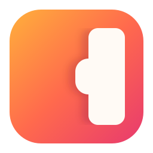

<div align="center">



# Noto

**A proper notes drawer for Windows.**

Native, local-first, keyboard-first, and quiet.

[](https://github.com/mdsaif45/Noto/actions/workflows/ci.yml)
[](LICENSE)
[](https://github.com/mdsaif45/Noto/releases/latest)

</div>

---

> **Status: v0.1, the Basic Release.** What is in it, and what is not yet, is
> in the [CHANGELOG](CHANGELOG.md).
>
> Noto is a drawer docked to a screen edge, shown and hidden by a global hotkey
> and a tray icon. It holds:
> - folders of notes as cards;
> - a Markdown editor with the markup hidden;
> - search as you type;
> - pictures and safe links;
> - a Recycle Bin;
> - backup, restore, export and import;
> - settings.
>
> The plan is in the [roadmap](docs/roadmap/roadmap.md).
>
> **The first product is SideNotes parity on Windows** —
> [SideNotes](https://www.apptorium.com/sidenotes/) is macOS-only, and nothing
> on Windows offers its edge-drawer model. Contextual notes, capture and
> competitor-inspired features come after that foundation is solid.

---

## Install

Download `Noto.App-win-Setup.exe` from the
[latest release](https://github.com/mdsaif45/Noto/releases/latest) and run it.
It needs 64-bit Windows 11.

- **No administrator rights and no wizard.** It installs for you alone,
  creates a *Noto* entry in the Start menu, and Noto starts.
- **The installer is not signed yet.** The first time, Windows shows *Windows
  protected your PC*: choose *More info*, then *Run anyway*. On a PC with Smart
  App Control turned on, Windows blocks it.
- **To upgrade,** run a newer installer. **To uninstall,** use Settings › Apps
  › Noto. Neither touches your notes, which live in `%LOCALAPPDATA%\Noto`.
- **Noto never uses the network.** It does not check for updates either.

---

## What it is

The information you need while working is almost never in the application
where you need it. So it ends up in a scratch file, a browser tab, or a sticky
note — and then it has to be found again.

Noto is a notes drawer that lives at the edge of your screen. Pull it out,
write or find what you need, and dismiss it — without leaving what you were
doing.

```
     your work                    |  Noto
  +--------------------------+    | +----------+
  |                          |    | | folders  |
  |    whatever you are      |    | | notes    |
  |    actually doing        |    | | editor   |
  |                          |    | |          |
  +--------------------------+    | +----------+
                                  ^
                    a keystroke away, gone when dismissed
```

Later, notes will also be able to follow the work they belong to — appearing
with the application they were written for. That is planned (M6), not built.

```
  FIRST                          LATER
  ─────────────────────────      ──────────────────────────────
  Workspace   an edge drawer     Capture      a hotkey from anywhere
              you pull out       Contextual   notes that appear with
  Floating    a note pinned                   the app they belong to
              above your work    and more
```

The workspace and floating notes are the first product. The rest is planned,
sequenced, and deliberately not rushed.

---

## Why it exists

Existing tools sit at one of two extremes:

```
        sticky notes                          Notion / Evernote / OneNote
        no structure, no search               not present while you work
                    |                                      |
                    +------------------+-------------------+
                                       |
                                 Noto is here
                        structured enough to find things,
                        present enough that you don't have to
```

On Windows specifically, research found the gap is real: the best products in
this category ([SideNotes](https://www.apptorium.com/sidenotes/),
[Noticky](https://www.noticky.app/)) are **macOS-only**, and **no mainstream
Windows product offers an edge-docked sidebar or supports markdown.** The
Windows sticky-notes category looks like 2010.

Full analysis: [docs/research/competitive-analysis.md](docs/research/competitive-analysis.md)

---

## Principles

- **Local-first.** No account, no cloud, no telemetry. Works on a plane.
- **Fast.** Under a second to usable. Effectively zero idle CPU.
- **Quiet.** Invisible until you ask for it.
- **Keyboard-first.** Every action has a keyboard path. Every trigger can be
  turned off.
- **Native.** Real Windows APIs, real Windows behavior.
- **Small on purpose.** Noto is not becoming Notion.

The full set, with the trade-off each one commits us to:
[docs/product/principles.md](docs/product/principles.md)

---

## Built with

```
  C# / .NET  +  WinUI 3  +  Windows App SDK  +  Win32 interop
  SQLite (Microsoft.Data.Sqlite + Dapper), FTS5 for search
  Markdown as the note format
```

Two choices worth explaining, because both depart from the obvious answer:

- **Not EF Core** — it cannot model FTS5, and full-text search is a core
  feature, not an add-on. ([ADR-003](docs/decisions/ADR-003-sqlite-data-access.md))
- **WinUI 3 is provisional** — it is weak at translucency, click-through and
  drag & drop, so the decision is gated on a full window-behaviour spike with
  WPF as the designated fallback.
  ([ADR-001](docs/decisions/ADR-001-native-windows-stack.md))

---

## Documentation

| | |
| --- | --- |
| [Vision](docs/product/vision.md) | What Noto is, and what it is not |
| [Principles](docs/product/principles.md) | The rules that decide what gets built |
| [First release](docs/product/first-release.md) | SideNotes parity — what ships first |
| [SideNotes parity](docs/product/sidenotes-parity.md) | The objective definition of done |
| [Strategy audit](docs/product/strategy-audit-2026-09.md) | Why the plan is shaped this way |
| [Roadmap](docs/roadmap/roadmap.md) | Milestones as capabilities |
| [Architecture](docs/architecture/architecture-overview.md) | How it is put together |
| [Data model](docs/architecture/data-model.md) | Schema and storage layout |
| [Decisions (ADRs)](docs/decisions/) | Why it is shaped this way |
| [Research](docs/research/) | Competitive and technical findings |

---

## Development

**Prerequisites:** Windows 11 (10 20H1+ should work), Visual Studio 2022 with
the .NET Desktop Development and Windows App SDK workloads.

```bash
git clone https://github.com/mdsaif45/Noto.git
cd Noto
dotnet build
```

```bash
dotnet test
```

**The installer** ([ADR-008](docs/decisions/ADR-008-packaging-and-identity.md)):

```bash
pwsh tools/packaging/New-Release.ps1 -Version 0.1.0
```

This writes `artifacts/release/Noto.App-win-Setup.exe`, a per-user install with
no administrator and no wizard. Uninstall it from Settings › Apps; your notes in
`%LOCALAPPDATA%\Noto` are always kept. The installer is unsigned for now, so on
first run Windows shows *Windows protected your PC*: choose *More info → Run
anyway*.

Noto is developed with heavy AI assistance, which makes architectural drift the
main long-term risk. The defense is
[ADRs](docs/decisions/): significant decisions are recorded before they are
implemented, and a change that contradicts one requires the record to be
reviewed first.

If you are contributing — including via an AI assistant — read
[CONTRIBUTING.md](CONTRIBUTING.md) first.

---

## Contributing

Issues and pull requests are welcome. The bar is about **fit** as much as code
quality: a good feature that does not belong in Noto is still a no. Read the
[principles](docs/product/principles.md) before proposing anything substantial.

- 🐛 [Report a bug](https://github.com/mdsaif45/Noto/issues/new?template=bug.yml)
- ✨ [Request a feature](https://github.com/mdsaif45/Noto/issues/new?template=feature.yml)
- 🔒 [Report a vulnerability](https://github.com/mdsaif45/Noto/security/policy) — privately, never as a public issue

---

## License

[MIT](LICENSE)

---

<div align="center">
<sub><i>Noto is a working name and may change before v1.0.</i></sub>
</div>
